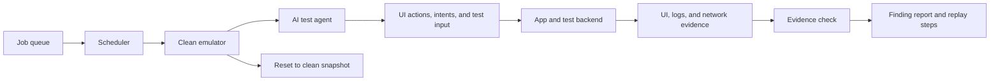

# Dynamic-analysis extension

Static analysis reads the APK. Dynamic analysis would run the APK in a safe test environment and watch what happens at runtime.

Each job would start with a clean Android emulator. The app would be installed with a test account and pointed at a disposable test backend. An AI agent would move through the app using the screen structure, screenshots, deep links, and controlled test input. It would keep track of the screens and actions it has already visited so it can explore more of the app instead of repeating the same path.

A finding should only be reported when there is proof. For example, an intent issue needs evidence that a protected target was actually reached. A WebView issue needs evidence that a controlled test page received a harmless canary value. An authorization issue needs two test users and proof that one user could read another user's data. The report would save the action steps, relevant logs or network records, and a short replay script.

For scale, a scheduler can give jobs to a pool of prebuilt emulators. Every job has a time limit and the emulator is reset after the job finishes. This prevents one test from affecting the next one and makes failures easier to retry.

SSL pinning can stop a proxy from seeing app traffic. In an authorized test environment, I would use a test build or approved runtime instrumentation to trust the test proxy certificate. The harness must record whether interception actually worked. Otherwise, an empty network trace could mean either that the app made no request or that the proxy was blocked.
