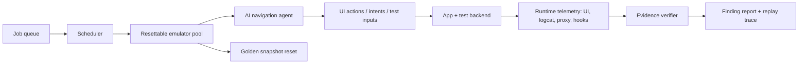

# Dynamic-analysis extension

I would add dynamic scanning as isolated jobs against a disposable test backend. A scheduler leases an emulator created from a golden snapshot, installs the APK, injects a per-job test account, and gives an AI agent a goal plus a bounded action budget. The agent explores with accessibility/UI hierarchy data, screenshots, deep links, and controlled intent or form inputs. It maintains a screen-and-state graph: nodes are screen fingerprints plus login state, and edges are actions. Coverage is measured as unique states, transitions, exported-component routes, and exercised network endpoints—not merely taps.

An agent should only confirm a finding when an oracle observes the security outcome. A crash is an observation, not proof. For example, an intent-redirection finding is confirmed only when a protected target is reached; a WebView issue is confirmed when a controlled origin receives a designated non-secret canary; an authorization issue is confirmed when two test users access different backend objects. The report stores the action trace, emulator snapshot ID, request/response evidence, relevant logs, and a minimal replay script. Dynamic testing can find server-side IDOR/authorization failures that static APK analysis cannot establish because the decisive authorization logic lives behind the backend.

Scale comes from an image pool, prewarmed emulators, sharded job queues, strict timeouts, and snapshot reset after every run. Jobs should be idempotent and retain only redacted artifacts. Failed runs are retried on a clean image, while deterministic repros are promoted to a smaller regression suite.

For SSL pinning, use a test build or authorized runtime instrumentation to add a trusted proxy CA or bypass the pinning check, then route traffic through a per-job proxy. The common failure points are native-library pinning that Java hooks miss, root/debugger detection that changes app behavior, and certificate-transparency or custom trust-manager checks. The harness must record whether interception was actually active; otherwise an empty proxy trace is ambiguous.
