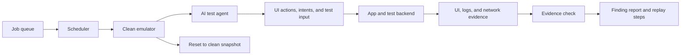

# Dynamic-analysis extension

Static analysis reads the APK. Dynamic analysis would run the APK in a safe test environment and watch what happens at runtime. This is useful for a backend authorization problem, such as IDOR: static APK code cannot prove that one real user can access another user's server-side record. For example, the agent can log in as test user A, request user A's order, then make the same controlled request for user B's order. If the backend returns user B's data, the authorization flaw is confirmed.

Each job would start with a clean Android emulator. The app would be installed with a test account and pointed at a disposable test backend. An AI agent would move through the app using the UI hierarchy, screenshots, deep links, and controlled form input. It would keep a simple map of visited screens, login states, and actions, so it can explore more of the app instead of repeating the same path. Coverage would be measured with unique screens, screen-to-screen actions, exported-component routes, and backend endpoints reached. This is more useful than simply counting taps.

A finding should only be reported when there is proof. For example, an intent issue needs evidence that a protected target was actually reached. A WebView issue needs evidence that a controlled test page received a harmless canary value. An authorization issue needs two test users and proof that one user could read another user's data. A crash alone is not proof of a security issue. The report would save the action steps, relevant logs or network records, and a short replay script.

For scale, a scheduler can give jobs to a pool of prebuilt emulators. Each job has a time limit, uses its own test account, and resets the emulator to a clean snapshot when it finishes. This prevents one test from affecting the next one. Failed jobs can be retried on a clean emulator, while reliable reproductions can become regression tests.

SSL pinning can stop a proxy from seeing app traffic. In an authorized test environment, I would use a test build or approved runtime instrumentation to trust the test proxy certificate. The main things likely to break are pinning implemented in a native library, root or debugger checks that change the app's behavior, and custom certificate or certificate-transparency checks. The harness must record whether interception actually worked. Otherwise, an empty network trace could mean either that the app made no request or that the proxy was blocked.
